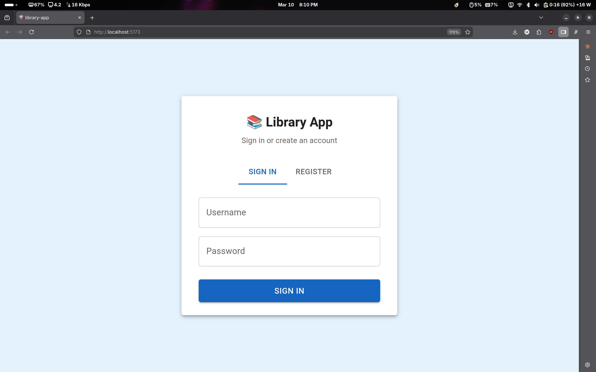
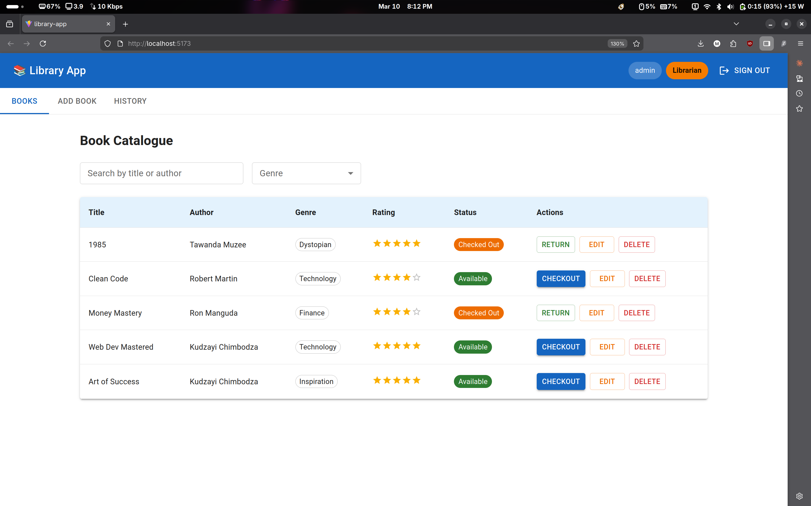
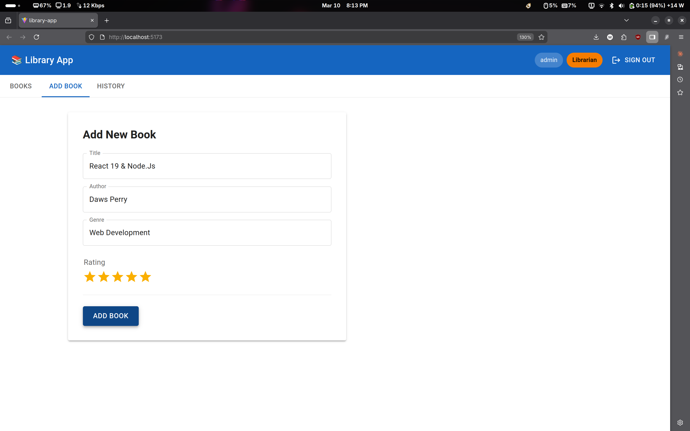
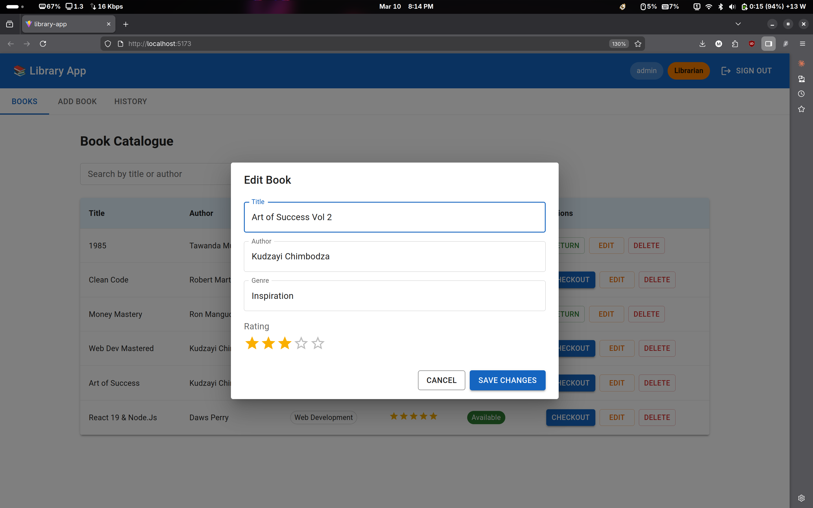
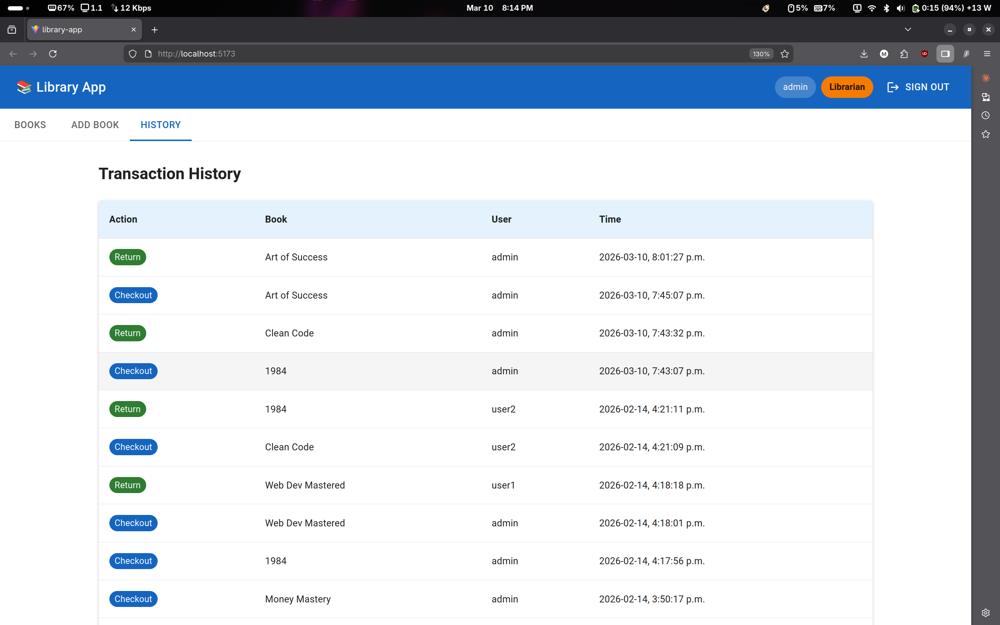

# Library App

A full-stack library management app built with React and Material UI, 
backed by a JSON Server REST API.

## Features
- Login and registration with role-based access (User / Librarian)
- Book catalogue with search and genre filter
- Checkout and return books
- Librarians can add, edit, and delete books
- Transaction history log

## Architecture

<p align="center"></p>

- **One React app, no backend code.** All data calls live in `src/api.js` and use `fetch` against JSON Server on port 3000.
- **Roles:** a user's role (`user` or `librarian`) is stored with their account. Librarians see the Add Book tab and the edit and delete buttons.
- **Checkout and return** change the book's `status` (`PATCH /books/:id`) and add a row to `/transactions`, which the History tab lists.

**Why this architecture**

| Choice | Why |
|---|---|
| JSON Server instead of a custom backend | A full REST API from one `db.json` file, so the work stays on the React side. |
| Material UI | Ready-made tables, tabs, dialogs and forms with a consistent look. |
| One `api.js` file for all requests | Components never build URLs; swapping JSON Server for a real API means changing one file. |
| Transactions as their own collection | Each checkout or return is kept as a record, so history survives later edits to the book. |

## Results

There are **no automated tests or CI** in this repo yet. What I checked on 13 Nov 2026 (Node 26, fresh `npm ci`):

| Check | Result |
|---|---|
| `npm run build` (Vite) | builds, 480 kB JS (146 kB gzip) |
| `npm run lint` (ESLint) | **2 errors**, both `react-hooks/set-state-in-effect`: `setState` called directly inside `useEffect` in `App.jsx` (restoring the user) and `EditDialog.jsx` (filling the form) |

The included `db.json` holds sample data: 4 users, 5 books and 16 transactions.

## What worked and what didn't

| | What | Detail |
|---|---|---|
| ✅ | Role-based UI | Users and librarians see different tabs and actions (see screenshots). |
| ✅ | Small, clear data layer | Every request is in `api.js`; components only call functions like `patchBook` and `addTransaction`. |
| ⚠️ limit | Roles are enforced in the UI only | JSON Server accepts any request, so anyone who can reach port 3000 can add, edit or delete books. |
| ⚠️ limit | Not real authentication | Passwords are stored in plain text in `db.json`, and login downloads the whole user list and compares in the browser. |
| ⚠️ limit | Checkout is two separate requests | The status `PATCH` and the transaction `POST` are not atomic; if the second fails, the book changes state with no history row. |
| ⚠️ limit | Lint errors and no tests | See Results above. |
| ⚠️ limit | API address is hard-coded | `api.js` uses `http://localhost:3000`, so the app only works with JSON Server on the same machine. |

## Screenshots


*Login page*


*Book catalogue with search, genre filter, and role-based actions*


*Add book form — librarian only*


*Edit book dialog*


*Transaction history log*

## Tech Stack
React 19, Material UI (MUI), Vite, JSON Server

## Run Locally

```bash
npm install
npm install @mui/material @emotion/react @emotion/styled @mui/icons-material
json-server --watch db.json --port 3000
npm run dev
```

(The MUI packages are already in `package.json`, so `npm install` already adds them and the second line is optional. JSON Server is not in `package.json`; install it globally or run it with `npx json-server`.)
